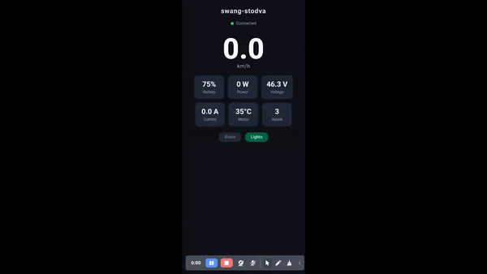

# swet102-app

Android companion app for [**Swet102**](https://github.com/OmoYauhen/swet102),
the firmware for the Bafang SW102 display on one e-bike (PET). Started as a copy
of [swang-stodva-app](https://github.com/OmoYauhen/swang-stodva-app).

What it's for: the display's **Player** and **Gate** pages. A press on the
handlebar becomes a notification over BLE; this app turns it into:

| Display | Phone |
|---|---|
| Player: LEFT click / RIGHT click | music volume − / + |
| Player: LEFT hold / RIGHT hold | previous / next track (media key to whatever is playing) |
| Player: RIGHT double-click | play / pause |
| Gate: LEFT / RIGHT | a Home Assistant service call for gate A / gate B |

It also shows the display's telemetry (speed, power, battery, PAS, city/sport,
lights, motor errors) and trips (ride, trip, battery trip, odometer with
max/avg/Ah), and updates the display's firmware over Bluetooth (**OTA** tab).

The display has no clock, so the app also sends it the **time of day and
today's sunset and sunrise**. The display's Lights **AUTO** mode uses them to
turn the bike lights on from 20 minutes before sunset until sunrise.

> **Status: new, untested on hardware.** Android only.

## Demo



▶ [Full-quality video](./assets/demo.mp4) — the 90 s demo loop, recorded on the
emulator (see [Emulator and demo mode](#emulator-and-demo-mode)).

The Ride screen is laid out like a car dashboard around a drawing of the bike.
A speed gauge marks the assist limit and turns amber above it. Four readings
point to the parts of the bike they come from: odometer to the rear wheel,
assist to the handlebar display, battery to the pack, and power to the motor.
The battery pack is coloured by charge, the motor glows with power, and the
headlamp throws a beam when the lights are on. Status lights for city/sport,
lights and motor link sit above it.

## How it works

Everything that has to work with the phone locked in a pocket is native Kotlin,
in a local Expo module (`modules/swet-link`). The React Native UI only shows
state and edits settings.

- **`SwetLinkService`**: a foreground service (ongoing notification, type
  `connectedDevice`). It calls `connectGatt(address, autoConnect = true)`, so
  Android connects in the background whenever the display turns on. No scanning
  after the first pairing. On every connect it reads the firmware build and
  version from Device Information (Software Revision `0x2A28`, Firmware Revision
  `0x2A26`; skipped on older firmware) and saves them for the OTA tab, then
  subscribes to commands, telemetry and trips again (the display doesn't bond,
  so it keeps no subscriptions). It starts again after a phone reboot or an app update, if it was on.
- **Commands**: volume through `AudioManager`, tracks and play/pause as media key
  events (like a headset button). Gates go to Home Assistant on a worker
  thread. Repeated notifications (same `seq`) are ignored.
- **Time sync**: as soon as the link is up, then every 10 minutes, the service
  writes the phone's local time and today's sunset/sunrise to the control
  characteristic (`'T'`, u32 seconds since local midnight, u16 sunset and u16
  sunrise in minutes since local midnight, little-endian). Times are wall-clock
  in the phone's time zone, DST included. Sunrise/sunset are computed offline
  (NOAA sunrise equation, `Sun.kt`) from the phone's last known coarse location,
  which is cached so it keeps working without a fresh fix; Warsaw if the app
  has never had one. A failed write is ignored until the next try.
- **Feedback** for gates, since you can't look at the phone while riding: **one
  short buzz** means it worked, **three** mean it failed. The Ride tab lists the
  recent commands and gate results.

- **Firmware update** (`DfuService`, Nordic's
  [Android DFU library](https://github.com/NordicSemiconductor/Android-DFU-Library)):
  Secure DFU to the display's bootloader (casainho's nRF5 SDK 12 bootloader),
  as a foreground service. While it runs, the link closes its connection and
  stays off, because the bootloader takes only one connection and autoConnect
  would grab it; it comes back when the update ends (done, failed or
  cancelled).

Protocol: swet102 `docs/TECH_DESIGN.md` §9.4. GATT base UUID
`8f03xxxx-da4c-453d-a163-41a592a0e9fd`, service `0001`, telemetry `0002`, command
`0003`, control `0004`, trips `0005`. Decoders: `src/protocol` (TypeScript) and
`Protocol.kt` (commands).

## Setup

1. Install the app (below), open **Setup → Find swet102** with the display on.
   That saves its address and starts the link.
   It also asks for **approximate location**, only for sunrise and sunset
   (Lights AUTO). It's optional: the app reads the location Android last had
   (no GPS fix, no Google Play services) and remembers it; without it, it uses
   the last place it knew, or Warsaw.
2. Allow the app to **ignore battery optimisation** (button in Setup); some
   phones kill background services otherwise.
3. **Gates:** enter your Home Assistant URL and a
   [long-lived access token](https://www.home-assistant.io/docs/authentication/#your-account-profile)
   (profile → Security), then a service and an entity for each gate, e.g.
   `button.press` + `button.gate_a`, or `switch.turn_on` + `switch.garage`, or
   `script.turn_on` + `script.open_gate`. The app sends
   `POST <url>/api/services/<domain>/<service>` with `{"entity_id": "<entity>"}`.
   **Test A / Test B** run the same call.

The URL must be reachable from wherever you ride (Nabu Casa, your own HTTPS
domain, or a VPN). The token is kept in the app's private storage on the phone.

## Firmware update (OTA tab)

1. **Choose firmware (.zip)**: a release package from swet102 (`make release` →
   `build/swet102-<YYMMDDHH>.zip`). The app reads its `manifest.json` and init
   packet and shows the build, e.g. `26101610 · 2026-10-16 10:00 UTC`. Only
   application packages are accepted; the image's size and SHA-256 must match
   the init packet.
2. Put the display into its bootloader by hand: **display off, then hold M + PWR
   for 8 s** until it shows up as `SW102_DFU`. The tab keeps scanning for it
   and shows its signal strength.
3. **Version check.** The bootloader only accepts a build (the init packet's
   `fw_version`, swet102's `VERSION_NUM`) newer than the installed one; anything
   else fails at the init packet with `OPERATION FAILED`. The app compares the
   zip with the build the display reported the last time the link was
   connected (DIS Software Revision), or the one it last installed. Newer:
   **Update**. Same or older: no Update button, with the reason. Unknown
   (firmware that doesn't report a build, or never connected): it says so and
   still offers Update.
4. **Update** shows the stage and progress, with **Cancel**. When it's done,
   turn the display **off, then on with a long PWR press**: the bootloader
   keeps advertising `SW102_DFU` until it's power-cycled.

## Build

On NixOS the flake provides the Android SDK/NDK, JDK and Node:

```bash
npm install
nix develop -c npx expo run:android        # build + install on a USB-connected phone
```

```bash
npm test                 # protocol decoders, OTA version logic (jest)
npm run type-check
nix develop -c bash -c 'npx expo prebuild -p android && cd android && ./gradlew :swet-link:testDebugUnitTest'
                         # Kotlin unit tests: command parsing, dedup, HA request,
                         # time-sync payload, sunrise/sunset, DST, DFU zip and
                         # init packet parsing
```

The UI also opens on web (`npm run web`), but without the native module it only
says that the link needs Android, unless demo mode is on (below).

### Emulator and demo mode

The emulator can't reach the display over BLE, so demo mode (`EXPO_PUBLIC_DEMO=1`,
set at bundle time) replaces the link with a fake 90 s ride that runs through
every dashboard state:

```bash
nix develop .#emulator -c swet-emu         # boots AVD "swet102" (created on first run)
nix develop -c npm run demo:android        # in a second terminal: build, install, Metro
npm run demo:web                           # or just the Ride screen in a browser
```

The bike drawing is generated from `assets/pet.svg` by `node scripts/gen-pet.mjs`.

## License

[MIT](./LICENSE)
